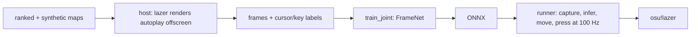
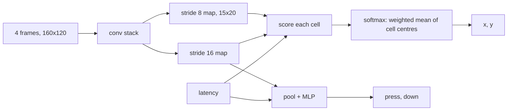

# osu-auto

An AI that plays osu!lazer (standard mode) from pixels only. Every 10 ms it sees the last few grayscale frames of the game window and decides where to move the cursor and whether to press or hold a key. It never reads the beatmap, game memory or hit objects.

It is trained by behaviour cloning on autoplay. A modified lazer build renders autoplay replays offscreen and exports downsampled frames together with the cursor and key labels for each step. Reinforcement learning on top of this is planned.

A rebuild of osu-ai on osu!lazer. The old project lives on the [legacy](https://github.com/TareHimself/osu-auto/tree/legacy) branch.

## Results

`joint_v4`, built from [configs/v4.yaml](configs/v4.yaml) on one skin (angelmegumin AI-friendly), evaluated closed loop in the host (the model drives the cursor and keys, the game judges):

| map | circle hit | accuracy |
|---|---|---|
| 1761111 [X] | 99.2% | 98.4% |
| Renatus [Hard] | 99.6% | 98.9% |

It spins spinners at 650 rpm, and still 530 rpm with 20 ms of added input delay. Training on several skins (list them under `skin:`) gives similar numbers on each of them.

## How it works



Every 10 ms the model sees the last 4 grayscale frames of the playfield at 160x120 and outputs where the cursor should be, whether a key goes down now (press) and whether a key is held (down).

### Data

Autoplay plays every map perfectly, so it is a free and unlimited teacher. `host/` runs a modified lazer headless: it steps the clock by exactly 10 ms, plays autoplay, reads each frame back from the GPU cropped to the playfield, and records autoplay's cursor and keys as labels.

- **No cursor in the frames.** It is drawn back in during training, so one export works with any cursor position, size or lag.
- **One skin per export.** The skin changes every pixel. A model trained on one skin did poorly on unseen ones (37 to 66% circle hit rate), and training on several fixed that. List several under `skin:` to export each map in each skin.

### Maps

Ranked maps alone keep the rare cases rare (big jumps, long streams, odd sliders).

- **Ranked** (`maps.py`): picked to cover a grid of star rating, CS and AR.
- **Synthetic** (`synth.py`): written to have the distribution we want, with flat positions, jump distances and angles, a range of tempos and slider shapes. Families: jumps, sliders, streams, dense, chains, patterns, mixed, spinners. They are seeded and byte-identical on every machine, so a config fully describes the training set.

### Model

`FrameNet`, a small conv net with about 2.4M parameters.



- **Soft-argmax aim.** The aim head scores each cell of a 15x20 grid and outputs the attention-weighted mean of the cell centres. This keeps the spatial layout and gives sub-cell precision. An extra loss pulls the attention towards a Gaussian around the target, so it stays sharp.
- **Aim encoding.** The playfield maps to 0.25..0.75 per axis, so the model can aim a little outside it, where some sliders and spinner circles go.
- **Clicks.** A pooled MLP head outputs press and down. Press is rare, so positives weigh 8x.

### Training tricks

All augmentation runs on the GPU, on chunks of frames that stay resident there (`gpu_data.py`).

- **Cursor compositing.** The skin's cursor is drawn at the label position from 0 to 5 steps earlier, at 0.5x to 1.6x size for half the samples. In the real game the cursor trails where the model wanted it, and players pick different cursor sizes.
- **Latency conditioning.** Each sample draws a latency of 0 to 40 ms. The aim label is shifted that far ahead and the latency is an input. The runner passes the frame's age plus inference time, so the model leads the cursor by the right amount.
- **Heat sampling.** Windows are weighted by strain, nearness to a press and spinners, instead of drawn uniformly. Most of a map is easy cursor travel.
- **Spinner recovery.** Autoplay never spins badly, so for 25% of spinner samples the cursor is drawn on a random circle at a random phase and speed, and the label is the next point at full speed. The model learns to pick up a spin from wherever the cursor is.
- **Click reweighting.** Spinners are oversampled for aim, which would teach the click heads that keys are mostly held. The click loss undoes that boost, except near a spinner's start and end.

### Evaluation and play

- **Closed-loop evals** (`evaluate.py`). Offline loss says little about play, so the model drives the cursor and keys in the host and the game judges every hit. `--delay N` makes every action N steps late.
- **Native runner** (`play/`). Windows Graphics Capture (or a Present hook), a GPU shader for gray and downsample, ONNX Runtime on CUDA, then `SendInput`. No Python in the loop.
- **ONNX parity.** The export is checked against PyTorch on real frames (0.5 px, 0.01 probability), so the runner plays the model that was evaluated.

## Layout

```
host/      C# lazer host (OsuAuto.Host): renders, judges and exports, controlled over ZeroMQ
lazer/     submodule: osu!lazer fork with the hooks the host needs (branch osu-auto)
py/        Python: map picking, synthetic maps, export jobs, training, evals, ONNX export
play/      native runner that plays the real game (see play/README.md)
configs/   run configs (YAML) for export and training
data/      maps, skins, exports, job lists and models (only data/jobs is tracked)
```

## Requirements

- Windows 11, x64, an NVIDIA GPU
- .NET 10 SDK
- [uv](https://docs.astral.sh/uv/) (Python 3.12+ is installed by uv)
- MSVC build tools (for the runner)

## Setup

```
git clone --recurse-submodules https://github.com/TareHimself/osu-auto
cd osu-auto
dotnet build host/OsuAuto.slnx -c Release
cd py && uv sync
```

Put your skin (`.osk`) in `data/skins/` and set it as `skin:` in the config. Skins are not in the repo. Maps are fetched in step 1.

## Pipeline

All Python commands run from `py/`.

**1. Get the maps**

Each step reads its settings from a run config. [configs/v4.yaml](configs/v4.yaml) is the current one: the synthetic map runs, the job list, skins, output folders and epochs. Flags on the command line override it.

The training set is `data/jobs/v3_all.json` (see [data/jobs](data/jobs/README.md)). Generate its synthetic maps (seeded, identical on every machine) and download its ranked maps:

```
uv run python -m osu_auto.synth --config ../configs/v4.yaml
uv run python -m osu_auto.maps --fetch ../data/jobs/v3_all.json
```

To build your own set instead: `maps --count 12 --download --jobs <list.json>` picks ranked maps, `synth --jobs <list.json>` generates synthetic ones.

**2. Export frames and labels** (runs several hosts in parallel, once per skin)

```
uv run python -m osu_auto.export_jobs --config ../configs/v4.yaml
```

This writes `data/jobs/train_v4.txt`, the exports that succeeded (in every skin, when the config lists several). To train on several skins, list them all under `skin:`.

**3. Train** (writes `joint_best.pt` and `joint_best.onnx` to the config's `out`)

```
uv run python -m osu_auto.train_joint --config ../configs/v4.yaml
```

Every training setting not in the config falls back to `train_joint`'s defaults (`--help` lists them).

**4. Evaluate in the host** (closed loop, the game judges)

Start a host with the skin to test on (from `host/`, it keeps its game storage in `host/headless/`), then point `evaluate` at it:

```
cd ../host && OsuAuto.Host/bin/Release/net10.0/OsuAuto.Host.exe serve --window 640x480 --skin ../data/skins/YOUR_SKIN.osk
uv run python -m osu_auto.evaluate ../data/beatmaps/<map>.osz --diff "<diff>" --model ../data/models/my_run/joint_best.pt
```

`--delay N` plays every action N steps (10 ms each) late, to test latency. `--trace out.npz` saves the cursor path and key presses.

**5. Play the real game**

```
uv run python -m osu_auto.promote my_run
cd .. && uv run --project play/shell silo run -C play/shell runner play
```

Click into lazer, press **F8** to start or stop the agent, **F9** to quit. See [play/README.md](play/README.md) for options, the capture hook and troubleshooting.

## Use

This is a research project. Do not use it to submit scores or play online. Play it offline, against unranked maps or in replays.

## License

[MIT](LICENSE)
