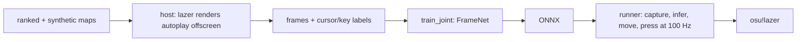

# osu-auto

An AI that plays osu!lazer (standard mode) from pixels only. Every 10 ms it sees the last few grayscale frames of the game window and decides where to move the cursor and whether to press or hold a key. It never reads the beatmap, game memory or hit objects.

It is trained by behaviour cloning on autoplay. A modified lazer build renders autoplay replays offscreen and exports downsampled frames together with the cursor and key labels for each step. Reinforcement learning on top of this is planned.

A rebuild of [osu-ai](https://github.com/TareHimself/osu-ai) on osu!lazer.

## Results

`joint_v3_skins3`, trained on three skins, evaluated closed loop in the host (the model drives the cursor and keys, the game judges):

| skin | 1761111 [X] circle hit / acc | Renatus [Hard] circle hit / acc |
|---|---|---|
| angelmegumin AI-friendly | 99.3% / 98.7% | 99.3% / 97.7% |
| moonshine eclipse | 98.2% / 95.5% | 98.6% / 95.5% |
| oka custom | 99.2% / 98.4% | 100% / 99.6% (full combo) |

It spins spinners at 500 to 670 rpm with up to 20 ms of added input delay.

## How it works



- **Data.** `host/` is a headless lazer host. It loads a map, plays autoplay and reads back each frame from the GPU, cropped to the playfield and downsampled to 160x120 gray. The cursor is not drawn. Training composites the skin's cursor sprite at the label position on the GPU, so the cursor position, size and lag can be varied freely.
- **Maps.** Ranked maps picked to cover a grid of star rating, CS and AR (`maps.py`), plus generated maps with flat position, jump and timing distributions (`synth.py`).
- **Model.** `FrameNet`: a small conv net over a stack of frames, about 2.4M parameters. Aim comes from a spatial soft-argmax over a 15x20 attention map. Press and hold come from two click heads. The model is told the expected input latency, so it learns to lead the cursor.
- **Playing.** `play/` is a native C++ runner: Windows Graphics Capture (or a Present hook) into a GPU gray and downsample shader, ONNX Runtime on CUDA, a 1 euro filter, then `SendInput`. No Python in the loop.

## Layout

```
host/      C# lazer host (OsuAuto.Host): renders, judges and exports, controlled over ZeroMQ
lazer/     submodule: osu!lazer fork with the hooks the host needs (branch osu-auto)
py/        Python: map picking, synthetic maps, export jobs, training, evals, ONNX export
play/      native runner that plays the real game (see play/README.md)
configs/   run configs (YAML) for export and training
data/      maps, skins, exports, job lists and models (only data/jobs is tracked)
```

## Requirements

- Windows 11, x64, an NVIDIA GPU
- .NET 10 SDK
- [uv](https://docs.astral.sh/uv/) (Python 3.12+ is installed by uv)
- MSVC build tools (for the runner)

## Setup

```
git clone --recurse-submodules <repo>
cd osu-auto
dotnet build host/OsuAuto.slnx -c Release
cd py && uv sync
```

Put skins (`.osk`) in `data/skins/`. Maps are fetched in step 1.

## Pipeline

All Python commands run from `py/`.

**1. Get the maps**

Each step reads its settings from a run config. [configs/v4.yaml](configs/v4.yaml) is the current one: the synthetic map runs, the job list, skins, output folders and epochs. Flags on the command line override it.

The training set is `data/jobs/v3_all.json` (see [data/jobs](data/jobs/README.md)). Generate its synthetic maps (seeded, identical on every machine) and download its ranked maps:

```
uv run python -m osu_auto.synth --config ../configs/v4.yaml
uv run python -m osu_auto.maps --fetch ../data/jobs/v3_all.json
```

To build your own set instead: `maps --count 12 --download --jobs <list.json>` picks ranked maps, `synth --jobs <list.json>` generates synthetic ones.

**2. Export frames and labels** (runs several hosts in parallel, once per skin)

```
uv run python -m osu_auto.export_jobs --config ../configs/v4.yaml
```

This writes `data/jobs/train_v4.txt`, the exports that succeeded in every skin. Skins are not in the repo; put your own `.osk` files in `data/skins/` and list them in the config.

**3. Train** (writes `joint_best.pt` and `joint_best.onnx` to the config's `out`)

```
uv run python -m osu_auto.train_joint --config ../configs/v4.yaml
```

Every training setting not in the config falls back to `train_joint`'s defaults (`--help` lists them).

**4. Evaluate in the host** (closed loop, the game judges)

Start a host with the skin to test on (from `host/`, it keeps its game storage in `host/headless/`), then point `evaluate` at it:

```
cd ../host && OsuAuto.Host/bin/Release/net10.0/OsuAuto.Host.exe serve --window 640x480 --skin ../data/skins/oka-custom.osk
uv run python -m osu_auto.evaluate ../data/beatmaps/<map>.osz --diff "<diff>" --model ../data/models/my_run/joint_best.pt
```

`--delay N` plays every action N steps (10 ms each) late, to test latency. `--trace out.npz` saves the cursor path and key presses.

**5. Play the real game**

```
uv run python -m osu_auto.promote my_run
cd .. && uv run --project play/shell silo run -C play/shell runner play
```

Click into lazer, press **F8** to start or stop the agent, **F9** to quit. See [play/README.md](play/README.md) for options, the capture hook and troubleshooting.

## Use

This is a research project. Do not use it to submit scores or play online. Play it offline, against unranked maps or in replays.
